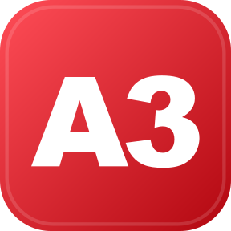
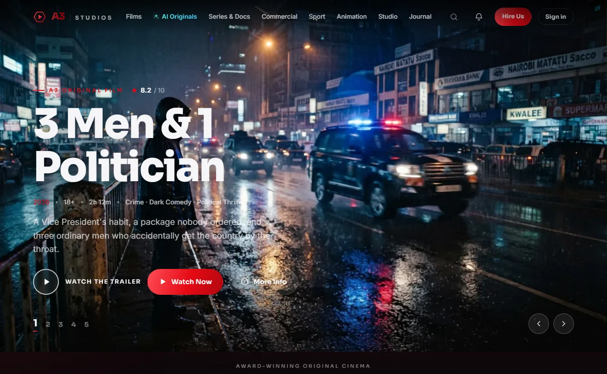
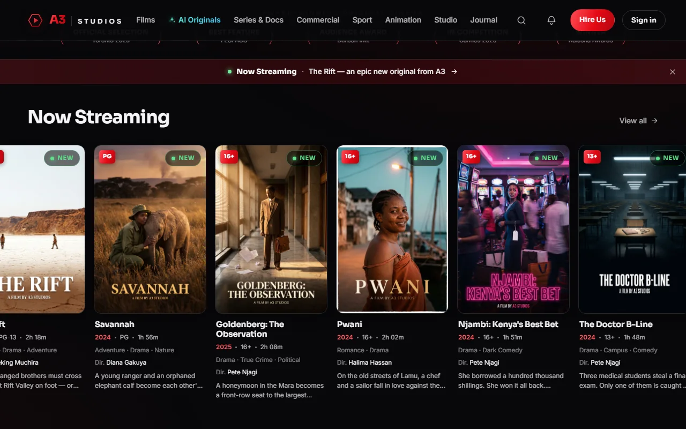

# A3 Studios

*One studio. Every format.*

[Visit A3 Studios](https://a3.ke/) · [Repository guide](#repository-guide)

## Idea

A Nairobi production studio for film, commercial video and live sport.

## Overview

A3 takes a brief from planning and shooting through editing and delivery. The public site shows the studio’s film, commercial video, and sport work in one catalogue.

The studio serves brands, agencies, broadcasters, and event organizers in Nairobi and across East Africa.

## Screenshots

**[A3 Studios homepage](https://a3.ke/)**



**[Production catalogue](https://a3.ke/)**



## Repository guide

### Tech stack

- **Vite 5** + **React 18** + **TypeScript**
- **React Router 6** — SPA with IIS rewrite to `index.html`
- Bespoke CSS design system in `src/index.css` (no UI framework)
- Static data in `src/data/films.ts` — no backend required

---

### Quick start

```bash
git clone https://github.com/PeteZDj/a3.ke.git
cd a3.ke
npm install
npm run dev          # http://localhost:5173
```

```bash
npm run build        # → dist/
npm run preview
npm run typecheck
```

---

### Project structure

```
a3.ke/
├── docs/screenshots/          README preview art
├── public/images/             posters + backdrops (optional per slug)
├── src/data/films.ts          single catalogue (Film · Series · Doc · Commercial · Sport)
├── src/pages/
│   ├── Commercial.tsx         branded & corporate video
│   ├── Sport.tsx              live & highlight coverage
│   └── …                      Home, Films, Series, About, Contact
└── src/index.css              cinematic design system
```

#### Adding a project

1. Add an entry to `src/data/films.ts` with the right `kind`.
2. Optionally add `public/images/posters/<slug>.jpg` and `public/images/backdrops/<slug>.jpg`.
3. Without images, gradient fallbacks render automatically.

---

### Deploy

Hosted at **[https://a3.ke](https://a3.ke)** on IIS (`C:\inetpub\wwwroot\a3.ke`).

```powershell
npm run build
robocopy dist C:\inetpub\wwwroot\a3.ke /MIR /XJ
```

---

### Studio

**Pete Njagi (Studio Head)** — A3 Studios, Industrial Area, Nairobi, Kenya

- Web: [a3.ke](https://a3.ke)
- Email: hello@a3.ke

---

<div align="center">

*Cinema, commercial video and sport coverage — made at home, seen everywhere.*

</div>
